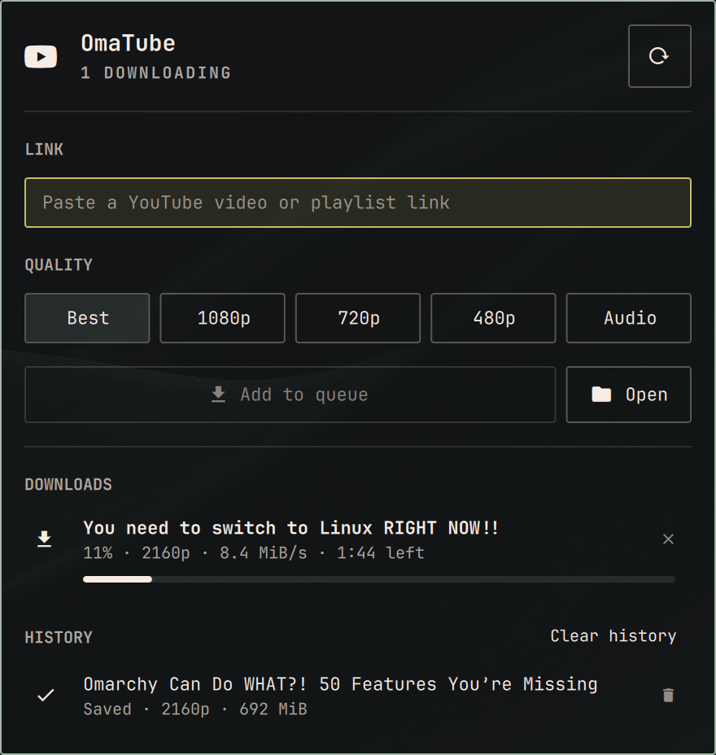

<div align="center">
  
</div>

# 📺 OmaTube for Omarchy

An [Omarchy](https://omarchy.org) bar widget for downloading from **YouTube**: videos, Shorts and whole playlists, in the quality you pick, straight into `~/Videos/OmaTube`.


## ✨ Features

- **Videos and Shorts**: any YouTube link works, whether it came from the address bar, the share button, a Short or YouTube Music
- **Whole playlists**: a playlist link downloads every video into a folder named after the playlist
- **Several at once**: five downloads run side by side by default (up to ten), and the rest wait in a queue
- **Notifications**: you hear back when a download finishes, fails, or a playlist is done
- **Stays up to date**: YouTube changes often, and a button in the panel checks for a new yt-dlp and installs it
- **One-click setup**: missing tools are installed from the panel
- **Native look**: built from Omarchy's own panel components and follows your theme


## 📦 Install

Requirements: Omarchy Quattro. OmaTube installs yt-dlp, ffmpeg and deno for you.

```bash
omarchy plugin add https://github.com/sxardas/omarchy-omatube.git --enable
```

Then click the icon in the bar and, if the panel asks for it, press **Finish setup**. It installs the missing packages, asking for your password once.


## 🖱️ Usage

| Action                    | Result                                                   |
|---------------------------|----------------------------------------------------------|
| **Left click**            | Open the panel: link, quality, downloads and history     |
| **Right click**           | Download the YouTube link in the clipboard               |
| **Middle click**          | Open the download folder                                 |

The icon in the bar shows how many videos are downloading or queued; hover it for their progress.


## ⚙️ Settings

Open the bar settings and pick OmaTube:

| Setting                         | Default            | Range                                                    |
|---------------------------------|--------------------|----------------------------------------------------------|
| Download folder                 | `~/Videos/OmaTube` |                                                          |
| Quality                         | Best               | Also used by right click and playlists                   |
| Parallel downloads              | 5                  | 1–10                                                     |
| Videos per playlist             | 1000               | 10–5000; 5000 takes all of any playlist                  |
| Download rows in the panel      | 10                 | 5–20                                                     |
| Rows per playlist               | 5                  | 1–10; videos shown under a playlist while it downloads   |
| History rows in the panel       | 10                 | 5–50                                                     |
| History entries kept            | 100                | 10–1000                                                  |
| Browser cookies on a bot check  | None               | Used only when YouTube asks to sign in                   |


## 🛠️ How it works

[`bin/omatube`](bin/omatube) wraps yt-dlp; nothing is re-encoded. Each download runs as its own systemd user unit, so a cancel stops yt-dlp and every ffmpeg with it. Unfinished files stay in `<folder>/.omatube.cache/` until they are done.


## 🗑️ Uninstall

```bash
~/.config/omarchy/plugins/io.github.sxardas.omatube/uninstall.sh
```

It removes exactly what OmaTube added: running downloads and their unfinished files, the `.omatube.cache` folder, the history, the bar entry with its settings and the plugin folder. Your videos stay, and so do yt-dlp, ffmpeg and deno.

`omarchy plugin remove` alone deletes the folder but leaves the history and the cache behind.

---

<div align="center">
  <sub>Built to watch videos offline, with no ads ;)</sub>
</div>
